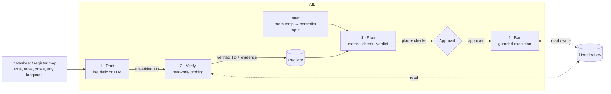

# Aether — AIL, Adaptive Interoperability Layer

**Turn undocumented devices into verified, machine-readable descriptions — then connect them by intent, not by guesswork.**

> Status: MVP / research prototype. Modbus TCP only, simulated devices, no production use.
> RS-200 and HC-10 are fictional devices used by the built-in simulator.

---

## Why this exists

Connecting two industrial or building devices is rarely hard because of the *protocol*. Gateways for Modbus, MQTT, OPC UA and HTTP are a solved problem. The expensive part is knowing **what the data means**:

- Register `40012` is "flow temperature in 0.1 °C" — but only the datasheet says so, and datasheets are wrong, outdated, or in another language.
- Two values can both be "temperature in °C" and still be completely different things (outdoor air vs. room air vs. flow temperature).
- Some values are commands, not measurements, and a few of them must never be written by a generic integration layer.

Most "universal interoperability" proposals assume devices describe themselves. Most real devices don't. AIL starts from the opposite assumption.

## The idea in one paragraph

AIL treats every device description as a **claim that needs evidence**. A drafter (heuristic or LLM) reads a datasheet and proposes a W3C WoT Thing Description. A verifier checks that claim against the live device, read-only, and proposes corrections when the data contradicts the documentation. A planner connects devices only in service of an explicit **intent**, and returns one of three verdicts — compatible, conditional, incompatible — with the reasons. Writes happen only after human approval, and safety-critical values are never written at all.



## What changed compared to the first concept

The original concept ("discover everything, normalise, match, connect") was sound in structure but put the effort in the wrong place. This version changes five things:

| Original concept | Revised model | Why |
|---|---|---|
| Automatic discovery of capabilities | **Draft → Verify**: descriptions are generated from documentation and then checked against the device | Modbus and most legacy devices cannot describe themselves; the description is the real work |
| Semantic matching of outputs to inputs | **Intent-driven planning**: connections exist only to serve a stated goal | Type compatibility is not meaning; "°C → °C" also matches outdoor temp to a room input |
| Descriptions are facts | Descriptions carry **provenance and verification status** | An LLM-drafted or datasheet-derived field is a hypothesis until evidence supports it |
| Safety as a policy list | Safety rules **enforced in code at plan and run time** | A rule that is only documented will eventually be bypassed |
| Service mesh, Node-RED, many protocols in scope | One protocol (Modbus) and one hard problem first | Breadth without a solved core produces a nicer Node-RED |

## Core concepts

### 1. Descriptions are W3C WoT Thing Descriptions with `ail:` extensions

AIL does not invent a device model. It uses the [WoT Thing Description](https://www.w3.org/TR/wot-thing-description11/) and its Modbus binding form shape, and adds a small, versioned extension vocabulary:

| Field | Meaning |
|---|---|
| `ail:quantityKind` | What is measured or controlled (`Temperature`, `RelativeHumidity`, …). Intended to map to QUDT. |
| `ail:roles` | What the value refers to (`room`, `outdoor`, `flow`, `setpoint`, `input`). Intended to map to Brick / SAREF. |
| `ail:dtype`, `ail:scale` | Raw encoding: `int16`/`uint16` and the multiplier from raw to engineering units |
| `ail:safetyCritical` | Must never be written by AIL |
| `ail:provenance` | Where the claim came from: source document, drafter, confidence, timestamp |
| `ail:verification` | Status (`unverified` / `verified` / `conditional` / `failed`), raw samples, problems found, proposed correction, who accepted it |

### 2. Verification produces evidence, not trust

For every property the verifier reads the device several times and checks the decoded values against

1. the range the datasheet claims, and
2. an **independent physical plausibility envelope** for that quantity and role (a room temperature of 215 °C is wrong no matter what the datasheet says).

If the data fails, it searches alternative interpretations (scale factors, signed vs. unsigned) and proposes the best fit. Accepting that proposal is a recorded human decision. Writable properties are marked `write: untested` — the verifier never writes.

### 3. Intents, not wiring

An intent states what should happen:

```json
{
  "name": "room-temp-to-controller",
  "source": {"quantityKind": "Temperature", "roles": ["room"]},
  "sink":   {"quantityKind": "Temperature", "roles": ["room", "input"]},
  "periodSeconds": 60
}
```

The planner finds matching properties across all registered devices, lists every **type-compatible near-miss it rejected and why**, and evaluates the best candidate.

### 4. Three verdicts with reasons

| Verdict | Meaning | Example |
|---|---|---|
| **Compatible** | Every check passes; can run without further input | Room humidity → monitoring log |
| **Conditional** | Works, but a human must decide something | Room temperature → controller input: first write is untested, values outside 0..40 °C will be clamped |
| **Incompatible** | A blocking check failed | Room temperature → flow setpoint: sink is safety-critical |

### 5. Safety rules, and where they are enforced

| Rule | Enforced in |
|---|---|
| Verification is read-only | `verify.py` has no write path |
| Unverified or corrected-but-unaccepted descriptions cannot produce a compatible plan | `planner.py` |
| Safety-critical properties are never written | `planner.py` (blocking check) **and** `run.py` (re-checked against current descriptions at execution) |
| Writes need an approved plan *and* an explicit `--apply` | `run.py` |
| Approval records who approved and which conditions they acknowledged | `run.py approve` |
| Real-time control and emergency stops stay in the local controller | By design: AIL only moves values at second-scale periods and never touches safety functions |

## The MVP

The MVP proves the core loop end to end against two simulated Modbus devices:

| Device | Port | Datasheet | Trap built into it |
|---|---|---|---|
| **RS-200** room sensor | 5020 | English | Datasheet says room temperature has scale `1`; the device actually sends `raw × 10` |
| **HC-10** heating controller | 5021 | **German** | Outdoor and flow temperatures look type-compatible with room temperature; flow setpoint is safety-critical; room input uses 0.5 °C steps |

### What the demo shows

1. **Draft**: both datasheets are turned into Thing Descriptions, including German labels (`Außentemperatur → outdoor`, `sicherheitsrelevant → safetyCritical`).
2. **Verify**: the RS-200 temperature reads as 215 °C. The verifier flags it, proposes `scale = 0.1`, and shows the corrected values (21.5 °C).
3. **Plan before correction**: conditional — the planner refuses to treat the source as verified.
4. **Accept correction**: a human accepts; the property is re-verified with fresh evidence.
5. **Plan three intents** → one compatible, one conditional, one incompatible, each with reasons and rejected near-misses.
6. **Run**: humidity is logged; room temperature runs as dry-run, then is approved and written (encoded to 0.5 °C steps, read back). The safety-critical intent is refused.

### Quick start

```bash
git clone https://github.com/hyphenpointhyphen/aether.git && cd aether
python -m venv .venv && source .venv/bin/activate
pip install -e ".[dev]"

ail demo            # whole pipeline against the built-in simulator
pytest -q           # 4 tests: drafting, scale correction, three verdicts, runner guards
```

Excerpt of `ail demo`:

```text
== 2. verify against the live devices (read-only)
RS-200 Wireless Room Sensor:
  [FIX?] room_temp    samples=[212.0, 212.0, 213.0] Cel
           -> outside datasheet range -10.0..50.0; physically implausible for Temperature room (expected 5.0..40.0 Cel)
           -> suggestion: dtype=int16 scale=0.1 gives [21.2, 21.2, 21.3]
  [OK  ] room_rh      samples=[44.2, 44.1, 44.4] %

== 5. plan all three intents
intent 'room-temp-to-controller': CONDITIONAL
  source: RS-200 Wireless Room Sensor.room_temp
  sink:   HC-10 Heizungsregler.t_raum_ext
  transform: read int16 * 0.1 -> Cel | clamp to 0.0..40.0 | encode / 0.5 as uint16 -> write
   + source RS-200 Wireless Room Sensor.room_temp verified against live device
   ? write path is untested: first activation needs human approval
   ? source range -10.0..50.0 exceeds sink range 0.0..40.0: values will be clamped
   - rejected HC-10 Heizungsregler.t_aussen: roles ['outdoor'] do not match source roles ['room']

intent 'room-temp-to-flow-setpoint': INCOMPATIBLE
   x sink HC-10 Heizungsregler.t_vl_soll is safety-critical; the AIL never writes it
```

### Step by step

```bash
ail sim &                                                    # simulated devices

ail draft examples/datasheets/rs200.md --endpoint modbus+tcp://127.0.0.1:5020/1 -o out/rs200.draft.json
ail draft examples/datasheets/hc10.md  --endpoint modbus+tcp://127.0.0.1:5021/1 -o out/hc10.draft.json

ail verify out/rs200.draft.json -o out/rs200.td.json                       # shows FIX? for room_temp
ail verify out/rs200.draft.json --accept-suggestions -o out/rs200.td.json  # human accepts
ail verify out/hc10.draft.json  -o out/hc10.td.json

ail plan --intent examples/intents/room-temp-to-controller.json \
         --things out/rs200.td.json out/hc10.td.json -o out/plan.json

ail run out/plan.json                         # dry-run
ail approve out/plan.json --by your-name      # records acknowledged conditions
ail run out/plan.json --apply --things out/rs200.td.json out/hc10.td.json
```

Use `--llm` on `ail draft` to draft from free-form documentation with an LLM (`pip install -e ".[llm]"`, set `ANTHROPIC_API_KEY`, optionally `AIL_LLM_MODEL`). LLM output is treated as untrusted: confidence is capped and it goes through exactly the same verification.

### Repository layout

```
ail/
  draft.py      datasheet -> Thing Description (heuristic + optional LLM drafter)
  verify.py     read-only probing, plausibility checks, correction proposals
  planner.py    intent matching, checks, three-way verdict, rejected candidates
  run.py        approval and guarded execution (dry-run by default)
  vocab.py      quantity/role keywords (EN + DE), units, plausibility envelopes
  bus.py        Modbus TCP access via pymodbus, encode/decode
  sim.py        dependency-free Modbus TCP simulator for RS-200 and HC-10
  cli.py        `ail` command
examples/
  datasheets/   rs200.md (EN, contains an error), hc10.md (DE)
  intents/      compatible / conditional / incompatible examples
tests/          end-to-end tests against the simulator
```

### Known limitations of the MVP

- **Plausibility is not proof.** If the correct and the documented scale both give plausible values (e.g. a value that is reasonable as 3.0 and as 30), the verifier cannot tell them apart. Stronger evidence (below) is needed.
- **Vocabulary is a keyword table**, not an ontology. Good enough to show the mechanism; it will miss synonyms and misclassify edge cases.
- **Only holding registers, single 16-bit values.** No 32-bit floats, word order, coils, bitfields or enums yet.
- **No persistent registry, no monitoring loop**, no authentication; the runner is a foreground loop.
- The LLM drafter is implemented but not yet evaluated; the demo uses the heuristic drafter so it runs offline and deterministically.

## Roadmap

**v0.2 — Make drafting measurable**
- A benchmark set of 30–50 real register maps with hand-verified ground truth.
- Measure heuristic vs. LLM drafter: field accuracy, and above all **false-accept rate** (wrong descriptions that pass verification).
- 32-bit values, word order, enums, bitfields.

**v0.3 — Stronger evidence**
- Cross-device correlation (two room sensors in one room should agree; a flow temperature should follow its setpoint).
- Active probing on a **test bench only**: write a value to an input, observe the reaction, then mark the write path verified.
- Drift monitoring: re-verify continuously and downgrade descriptions when behaviour changes (e.g. after a firmware update).

**v0.4 — Breadth, on a proven core**
- MQTT and OPC UA sources (OPC UA nodes already carry partial semantics — verification becomes cheaper).
- Map `ail:quantityKind` / `ail:roles` onto QUDT, Brick and SAREF; export to the Asset Administration Shell (AAS).
- Persistent registry with versioned descriptions and audit log.

**Later — the network effect**
- A shared catalogue of **verified descriptions per device model and firmware**, so each device type is described and verified once and reused everywhere. This is where the real reduction in integration work comes from.

### How to know if it works

| Metric | Target for a useful v1 |
|---|---|
| Time to integrate a new, undocumented device type | Minutes instead of hours |
| Share of properties verified without manual edits | > 80 % |
| False-accept rate (wrong description marked verified) | < 1 %, and measured |
| Unsafe writes | Zero, by construction |

## Relation to existing work

AIL is meant to sit next to, not replace, these:

- **W3C Web of Things** (Thing Description, Modbus binding; Eclipse Thingweb / node-wot) — the description format AIL produces.
- **OPC UA** information models and **Asset Administration Shell** (Eclipse BaSyx) — richer industrial models; targets for export, not competitors.
- **FIWARE / NGSI-LD**, **oneM2M** — cross-domain IoT data models and platforms.
- **Brick**, **Project Haystack**, **SAREF**, **QUDT** — semantic vocabularies AIL's tags should map onto.
- **Node-RED** and industrial DataOps hubs — manual integration tooling; AIL's plans could be exported to them.
- **Semantic web service composition** (OWL-S, WSMO, ~2004–2012) — tried automatic matching of described services and stalled because descriptions were never accurate enough. AIL's bet is that LLM drafting plus live verification changes that economics.

## License

TBD (Apache-2.0 suggested).
